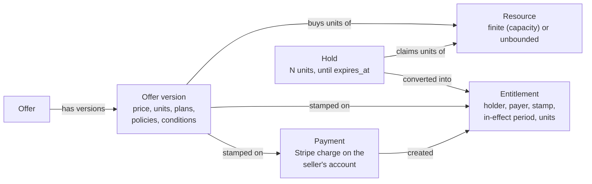
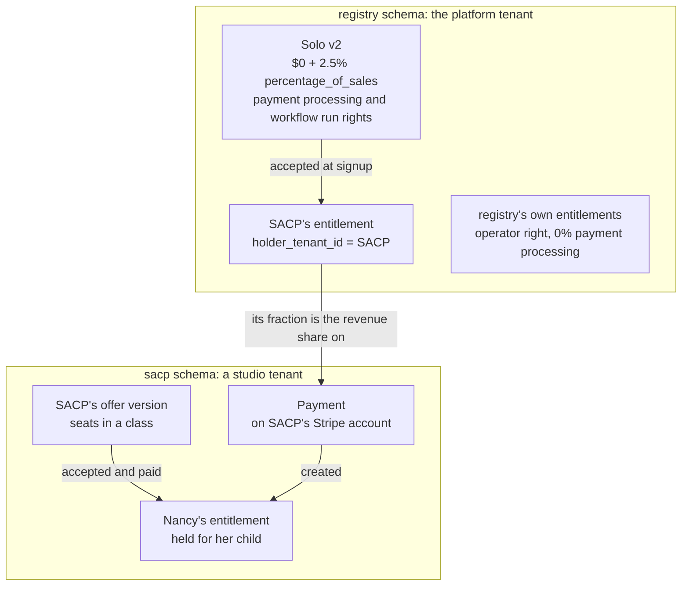

# PriceOps Model

PriceOps is the part of Registry that models what a tenant sells to its
customers and what those customers then hold. This document describes what is
built, for the developer who next adds a product. The next product should be an
instance of this model, not a new argument about it.

The design, and the order it was built in, is in the PriceOps model design
spec (dated 2026-11-21, on the `docs/priceops-model-design` branch).
perigrin's rulings on it are in [ADR 004](../decisions/004-step-6-workflow-reach-and-storefront.md)
and [ADR 005](../decisions/005-priceops-day-one-rulings.md). Where this
document and the spec differ, this document describes the code, and the
difference is listed under [Where the code differs from the spec](#where-the-code-differs-from-the-spec).

Related documents:

- [Publishing Offers](../guides/publishing-offers.md): the screens a tenant
  admin uses to publish an offer.
- [Workflows](workflows.md): how workflows, steps and the background driver
  work.
- [Offers and Subscriptions](offers-and-subscriptions.md): the same pattern
  seen at the platform scale and the tenant scale.
- [SACP Stripe Connect Onboarding](../operations/sacp-stripe-connect-onboarding.md):
  how a studio's Stripe account is wired up, and what each Stripe event does.

---

## The model in one page

| Term | What it is | Table |
|---|---|---|
| Resource | Something a tenant controls access to: seats in an occurrence, payment processing, the operator right | `resources` |
| Offer | The family name for a tenant's terms for a resource | `offers` |
| Offer version | One numbered, immutable set of terms: price, units, payment plans, policies, conditions | `offer_versions`, `offer_version_payment_plans` |
| Entitlement | What a holder has after accepting an offer version under one of its payment plans | `entitlements`, `entitlement_units`, `entitlement_uses`, `entitlement_refunds` |
| Hold | A time-limited claim on N units of a finite resource, for one workflow run | `holds` |
| Payment | The Stripe charge that created an entitlement, stamped with the terms it was sold under | `payments` |

### Resource

A resource is something a tenant controls access to. `kind` is `finite` or
`unbounded`. A finite resource has a `capacity` (0 is allowed, for a closed or
sold-out occurrence). An unbounded one has none and is limited only by policy.

An occurrence (an `events` row) can be its own finite resource, through
`resources.event_id`. Its start and end are read from the event by
`Resource->occurrence_window`.

DAO: `Registry::DAO::Resource` (`lib/Registry/DAO/Resource.pm`).

### Offer and offer version

An offer is a name. Its terms live on its versions. A version is a draft while
`published_at` is empty, and current while published and not superseded. Each
offer has at most one current version, enforced by a unique index.

A version buys either one named resource (`resource_id`) or every occurrence of
a class (`class_project_id`), including occurrences made after it was
published. `OfferVersion->covered_resources` is the one coverage rule.

A version carries:

- `price_cents` and `currency`;
- `units_per_acceptance` (two seats for a couple) and `per_booking_cap`;
- **payment plans**, as rows in `offer_version_payment_plans`. A plan's `kind`
  is `one_time` or `percentage_of_sales`. A percentage-of-sales plan carries a
  `fraction` from 0 to 1, at most 4 decimal places;
- **policies**, a JSON object with `refund`, `change`, `use` and `expiry`
  entries. The vocabulary is `%POLICY` in `lib/Registry/DAO/OfferVersion.pm`.
  A policy that does not match a declared shape is refused, never guessed at;
- **conditions**, a JSON list of requirements, also declared shapes:
  `family_holds_entitlement` (a sibling rate) and `holder_is_offerer` (the
  platform's offers to itself).

**Immutable once published, enforced in the database.** The trigger function
`offer_version_immutable` (`sql/deploy/priceops-offer-versions.sql`) refuses
any change to a published version except setting `superseded_at` once, and
refuses deleting one. The function `offer_version_payment_plan_immutable`
(`sql/deploy/priceops-offer-policies.sql`) does the same for its payment
plans. A version is published only with at least one payment plan and a refund
policy. A change to an offer is a new version. `OfferVersion->publish`
supersedes the current version and publishes the draft in one transaction.

DAOs: `Registry::DAO::Offer` (`lib/Registry/DAO/Offer.pm`) and
`Registry::DAO::OfferVersion` (`lib/Registry/DAO/OfferVersion.pm`).

### Entitlement

An entitlement records:

- **the holder**: exactly one of `holder_user_id` (a person),
  `holder_family_member_id` (a child) or `holder_tenant_id` (a tenant, in
  `registry` only);
- **the payer**, `payer_user_id`, set only when someone other than the holder
  paid, such as a parent for a child;
- **the stamp**: `offer_version_id` and `payment_plan_id`, with `offer_id` and
  `plan_kind` copied at insert. The trigger function `entitlement_stamp` refuses a draft
  version and refuses any later change to the stamp;
- **the in-effect period**, `in_effect`, a half-open `tstzrange`. A period
  ending at T and one starting at T do not overlap;
- **the held units**, for a discrete entitlement, as rows in
  `entitlement_units`. One entitlement holds units of one resource, so seats in
  two occurrences are two entitlements;
- **its state**: `active` until `Entitlement->end` moves it, once, to
  `expired`, `refunded` or `dispute_lost`. Ending records `ended_at` and
  `ended_reason` and closes the period. The database refuses any move out of an
  ended state;
- **the payment that created it**, `payment_id`, and its share of that payment,
  `payment_share_cents`. One payment may create several entitlements. Both are
  set only at insert.

There are two ways in. `Entitlement->accept` takes a schedule-type plan (any
kind but `one_time`), and refuses a version that is not current. A one-time
plan is accepted by paying: `Entitlement->grant`, or `Hold->convert` once a
payment succeeds, creates the entitlement with its units.

DAO: `Registry::DAO::Entitlement` (`lib/Registry/DAO/Entitlement.pm`).
Holds: `Registry::PriceOps::Hold` (`lib/Registry/PriceOps/Hold.pm`).

### Payment

A payment is a row in the selling tenant's `payments` table, for a direct
charge on that tenant's own Stripe account
([ADR 003](../decisions/003-direct-charges-stripe-source-of-truth.md)). It is
stamped with:

- `offer_version_id`: the seller's offer version it was sold under, fixed once
  set (`sql/deploy/payments-offer-version-stamp.sql`);
- `platform_offer_version_id` and `platform_payment_plan_id`: the platform
  terms the fee was taken under.

Only two payment plan kinds exist. A one-time plan is paid up front by the
`OneTimePayment` step. A percentage-of-sales plan is never invoiced: it is
collected on each of the holder's own sales, as that sale's
`application_fee_amount`. A fee of 0 is omitted from the charge, never sent
as 0.

### Metering

Metering is not built. Nothing records email sends, workflow runs or AI tokens
against an entitlement, and no offer is priced per use. It is step 9 of the
spec's order of work.

---

## The platform is just a tenant

The platform tenant is `registry`, and the `registry` schema is its tenant
schema. Its customers are the other tenants. It uses the same tables, DAOs,
steps and screens as any tenant.

- **The platform's offers to tenants are ordinary offer versions** in
  `registry.offer_versions`. On day one there is one, Solo: $0 plus a 2.5%
  `percentage_of_sales` plan, with a refund policy of
  `keep_fee_with_admin_exception`. It is seeded by
  `sql/deploy/bootstrap-platform-offers.sql`. Later versions are published
  through `offer-publishing`, like any tenant's
  ([Publishing a later Solo version](../guides/publishing-offers.md#5-publishing-a-later-solo-version)).
- **Its sales are ordinary entitlements** in `registry.entitlements`, with
  `holder_tenant_id` naming the tenant.
- **The revenue share is the percentage-of-sales plan of the tenant's
  entitlement from the platform.** Every reader asks one resolver:
  `Registry::PriceOps::PlatformTerms::platform_terms_for_tenant`
  (`lib/Registry/PriceOps/PlatformTerms.pm`). It returns the tenant's in-effect
  platform entitlement to the resource `payment processing`: its offer
  version, payment plan, fraction (an exact decimal string such as `"0.025"`)
  and refund policy. `Registry::PriceOps::RevenueShare` reads it for the
  charge-time rate. A refund resolves backwards with `platform_version_terms`,
  from the version stamped on the payment.
- **A tenant holds one platform payment-processing entitlement at a time.**
  The trigger `entitlement_one_platform_term`
  (`sql/deploy/platform-entitlement-one-in-effect.sql`) refuses a second.
- **The platform's offers to itself** carry the condition `holder_is_offerer`.
  The trigger `entitlement_holder_is_offerer`
  (`sql/deploy/self-offer-guard.sql`) lets only the platform tenant hold them.
  Its own payment processing is an explicit 0%, so its own sales send no fee
  by the ordinary rule, not by a check for the platform.
- **The operator right is an entitlement only `registry` holds**, to the
  resource `operator` (`sql/deploy/operator-right-entitlement.sql`). It covers
  acting as another tenant, the job queue and the cross-tenant revenue view.
  `Tenant->holds` and `Tenant->admin_of_holder` ask for it by resource name,
  and only admins of the holding tenant may use it.
- **There is always a platform offer to sign up to.** The trigger
  `offer_versions_keep_platform_offer`
  (`sql/deploy/platform-offer-to-tenants-guard.sql`) refuses retiring the last
  one.

---

## Tables, schemas and DAOs

Every PriceOps table exists in `registry` and in every tenant schema. Each
migration builds it in `registry` first and then loops over the tenants, and
`clone_schema` gives a new tenant the same tables.

- In a **tenant schema** the tables hold that tenant's resources, offers and
  its customers' entitlements, held by its people and children.
- In **`registry`** they hold the platform's resources and offers, and the
  entitlements tenants hold from it. Code that reads what a tenant holds from
  the platform qualifies the table as `registry.entitlements`. A tenant
  schema's copy of an entitlement never names a real tenant and grants
  nothing.

**No foreign key crosses schemas.** Each table's foreign keys name tables in
its own schema. The registry-only rules (one platform term, self-offers, the
platform-offer guard) are triggers that do nothing in a tenant schema's copy.

| Table | What it holds | Migration | Code |
|---|---|---|---|
| `resources` | Finite or unbounded resources; an occurrence's seats | `sql/deploy/priceops-offer-versions.sql`, `sql/deploy/priceops-occurrence-resources.sql` | `lib/Registry/DAO/Resource.pm` |
| `offers` | Offer names | `sql/deploy/priceops-offer-versions.sql` | `lib/Registry/DAO/Offer.pm` |
| `offer_versions` | Immutable terms, policies and conditions | `sql/deploy/priceops-offer-versions.sql`, `sql/deploy/priceops-offer-policies.sql` | `lib/Registry/DAO/OfferVersion.pm` |
| `offer_version_payment_plans` | A version's payment plans | `sql/deploy/priceops-offer-policies.sql` | `lib/Registry/DAO/OfferVersion.pm` |
| `entitlements` | Holder, payer, stamp, period, state, payment link | `sql/deploy/priceops-entitlements.sql`, `sql/deploy/priceops-entitlement-one-phase.sql`, `sql/deploy/priceops-entitlement-lifecycle.sql` | `lib/Registry/DAO/Entitlement.pm` |
| `entitlement_units` | The numbered units an entitlement holds | `sql/deploy/priceops-entitlement-units.sql` | `lib/Registry/DAO/Entitlement.pm` |
| `holds` | Time-limited claims on units, per workflow run | `sql/deploy/priceops-entitlement-units.sql`, `sql/deploy/holds-placed-at.sql`, `sql/deploy/holds-lifetime.sql` | `lib/Registry/PriceOps/Hold.pm` |
| `entitlement_uses` | One recorded use per entitlement and occurrence | `sql/deploy/entitlement-uses.sql` | `lib/Registry/DAO/Entitlement.pm` |
| `entitlement_refunds` | Each entitlement's part of each Stripe refund | `sql/deploy/priceops-entitlement-lifecycle.sql`, `sql/deploy/entitlement-refunds-per-entitlement.sql` | `lib/Registry/DAO/Entitlement.pm` |

### One in-effect phase of a schedule-type entitlement

A holder has one phase of an offer's schedule in effect at a time. An
exclusion constraint on `entitlements`
(`sql/deploy/priceops-entitlement-one-phase.sql`) refuses two entitlements
with the same holder and the same `offer_id` whose `in_effect` periods
overlap, where `plan_kind` is not `one_time`. Each tenant's table holds only
its own sales, so this is per holder per seller. On day one the only
schedule-type kind is `percentage_of_sales`, such as Solo.

Discrete seat entitlements (`one_time`) are not limited by it. One holder may
hold seats in two occurrences of one offer. Seats are limited by capacity
instead.

---

## Rules that hold

**Stamping, and resolve backwards.** An entitlement keeps the offer version and
payment plan it was sold under, and a payment keeps the versions it was
charged under. Lifecycle steps read the stamped version, never the current
one. A later version changes no existing entitlement's terms.

**Absence is not zero.** When nothing resolves, Registry refuses.
`platform_terms_for_tenant` dies, naming the tenant, when the tenant holds no
platform entitlement in effect. It is never charged at 0%. The old Free plan is
gone (`sql/deploy/remove-free-platform-plan.sql`). A refund request under an
unknown refund policy is refused, never read as a full refund.

**PriceOps never moves money.** It decides what is owed. Stripe moves the money
and is the truth for it. A refund request is sent to Stripe, and the
entitlement ends only when Stripe reports the refund.

**Stripe-reported moves are applied without policy gating.** A refund made in a
tenant's Stripe dashboard, or a lost dispute, has already happened. The
`entitlement-stripe-move` workflow applies it whatever the offer's policies
say:

- a full refund ends the entitlement as `refunded` and frees its units;
- a partial refund is recorded in `entitlement_refunds` and leaves it in
  effect;
- a lost dispute ends it as `dispute_lost`. Opened, won or otherwise closed
  disputes change nothing.

**Refunds are per entitlement**, never the whole cart. A refund of a payment
that bought several entitlements is shared among them.

**Checks name the resource, never a plan.** Code asks "does this tenant hold
`operator`?" or "how many units of this occurrence are free?". No branch reads
an offer's or a plan's name. Where overrunning matters, the check reads live
state: every grant and hold takes the resource's row lock and counts held
units and live holds at that moment (`Resource->claim`).

---

## The lifecycle

Every move of an entitlement goes through its stamped policies or through a
Stripe report. No step carries its own refund, change or expiry rule.

| Move | Workflow | Step classes | What it does |
|---|---|---|---|
| Accept and pay (a tenant) | `tenant-signup` | `TenantPayment`, `RegisterTenant` | Signup is the platform's accept-and-pay. It lists `platform_offers_to_tenants`, with Solo preselected, and `Tenant->provision` accepts the chosen version for the new tenant in `registry`. No card is taken. |
| Pay a one-time amount | composed into a workflow | `OneTimePayment` | Charges what a prior step owes under a stamped version. When a hold is owed for, it charges only while that hold is live. |
| Use | none yet | `RecordEntitlementUse` | Records one use per entitlement and occurrence, when the use policy is `optional_attendance`. Changes no state, units or money. |
| Change | `entitlement-change` | `ChooseChangeTarget`, `HoldChangeTarget`, `PayChangeFee`, `CompleteChange` | Checks the stamped change policy, holds the target seats first, then charges the fee. Once paid, it moves the same entitlement onto the held units. |
| Refund request | `entitlement-refund` | `SelectEntitlementForRefund`, `ApplyRefundPolicy` | Decides by the stamped refund policy and asks Stripe for the refund. It never ends the entitlement itself. |
| Stripe-reported move | `entitlement-stripe-move` | `ApplyStripeRefund`, `ApplyStripeDispute` | Applies a stored refund or dispute event, as above. |
| Platform fee exception | `platform-fee-refund-exception` | `FindTenantPayment`, `RecordFeeRefundException`, `ApplyFeeRefundException` | An admin of the tenant holding the operator right returns the platform fee on a payment whose stamped platform refund policy is `keep_fee_with_admin_exception`. |
| Expiry | none: a recurring job | `Registry::Job::ExpireEntitlements` | Ends as `expired` each active entitlement whose expiry policy is `end_of_occurrence`, once its occurrence ends, in every schema. |

The workflows are in `workflows/tenant-signup.yml`,
`workflows/entitlement-change.yml`, `workflows/entitlement-refund.yml`,
`workflows/entitlement-stripe-move.yml` and
`workflows/platform-fee-refund-exception.yml`. The step classes are in
`lib/Registry/DAO/WorkflowSteps/`. The expiry job is
`lib/Registry/Job/ExpireEntitlements.pm`.

**A change holds the target first.** `HoldChangeTarget` places a time-limited
hold on the target's seats before any charge. If the charge fails, the hold
lapses and stops counting. If the fee is paid after the hold lapsed,
`CompleteChange` takes the seats again if they are free, and otherwise flags
the run for an admin. Registry never refunds a change fee. A fee of 0 owes
nothing and is passed through.

**Steps no person is waiting on** run through the background driver: the
second half of a change once Stripe reports the payment, and every
`entitlement-stripe-move` run. See
[Runs no person is waiting on](workflows.md#runs-no-person-is-waiting-on).

---

## Adding a product

**A new offer is data.** A new price, a new version of an offer, or a new
combination of the existing payment plans and policies needs no code and no
deploy. A tenant admin publishes it through the `offer-publishing` workflow;
see [Publishing Offers](../guides/publishing-offers.md).

**A new kind of behaviour is a new step class.** A new payment plan kind, a new
policy kind or a new condition kind needs:

1. its shape declared in `%POLICY` or `%CONDITION` in
   `lib/Registry/DAO/OfferVersion.pm` (a new payment plan kind is also a new
   value in the database's `kind` check, with its own columns);
2. a workflow step class that applies it, which joins the server-side
   allowlist of step classes
   ([ADR 002](../decisions/002-workflow-step-class-allowlist.md));
3. a sqitch change for any schema change, built in `registry` and every tenant
   schema.

Never add a branch on an offer's name or a plan's name.

---

## Not yet built

- Metering (step 9).
- Instalment, recurring and pay-as-you-go as PriceOps payment plan kinds.
  (After-school instalments exist on the separate `pricing_plans` path.)
- Evaluating conditions at acceptance. `family_holds_entitlement` is stored and
  shape-checked but nothing reads it yet. `holder_is_offerer` is enforced by
  its trigger in `registry`.
- A workflow that sells a seat. `OneTimePayment`, holds and
  `RecordEntitlementUse` are built and tested; in-studio booking (step 7)
  will compose them.
- Workflows as entitlements. The bootstrap seeds `run:<slug>` resources and
  `registry`'s entitlements to them, but the workflow gate reads each
  workflow's `roles` and `public` mark, not entitlements. See
  [Who may run a workflow](workflows.md#who-may-run-a-workflow).
- After-school on this model (step 8). After-school still prices from
  `pricing_plans` and records enrollments.

---

## Where the code differs from the spec

- **Payment is not a policy key.** The spec lists payment among an offer's
  policies. In the code, payment plans are rows in
  `offer_version_payment_plans`, and `policies` holds only `refund`, `change`,
  `use` and `expiry`.
- **Change is not an ending state.** The spec lists an entitlement's life as
  used, changed, refunded and expired. In the code a change moves the same
  entitlement (same id, state and payment link) onto new units, and a use
  records a row. The ended states are `expired`, `refunded` and
  `dispute_lost`.
- **The one-phase rule is per offer, plus a platform trigger.** The spec states
  one schedule phase in effect at a time. The exclusion constraint covers one
  offer; a separate trigger covers two platform offers for the same resource
  (`payment processing`).
- **Signup lists only $0 platform offers.** `platform_offers_to_tenants` lists
  versions with no price, because signup takes no card.
- **Conditions are stored, not evaluated**, except `holder_is_offerer`.
- **A failed change charge does not release the hold.** The spec says the hold
  is released when the charge fails. In the code a failed charge leaves the
  run on the pay step, and the hold lapses at its `expires_at`. A failed
  Stripe charge can still be retried and paid, so it is not released early.
